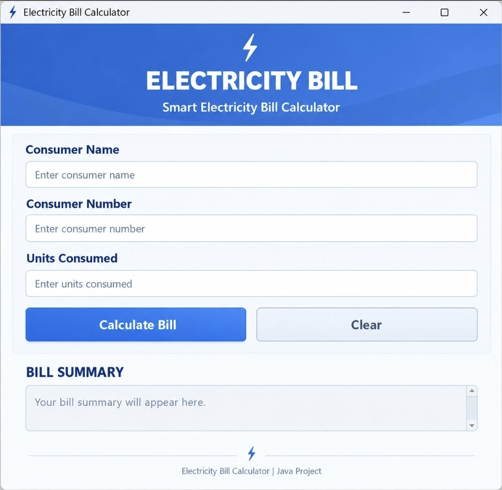

# ⚡ Electricity Bill Calculator

A desktop-based Electricity Bill Calculator developed using Java Swing. This application calculates electricity bills based on consumer details and units consumed.

## 📌 About the Project

The Electricity Bill Calculator is a Java GUI application designed to simplify electricity bill calculation. Users can enter their consumer details and electricity consumption to calculate the total bill based on predefined tariff rates.

## ✨ Features

- Enter Consumer Name
- Enter Consumer Number
- Enter Units Consumed
- Automatic Bill Calculation
- Displays Detailed Bill Receipt
- Input Validation
- Error Handling
- Clear Button to Reset Fields

## 🛠️ Technologies Used

- Java
- Java Swing
- AWT (Abstract Window Toolkit)

## 💰 Tariff Structure

| Units Consumed | Rate per Unit |
|----------------|---------------|
| 0–100          | ₹2            |
| 101–200        | ₹3            |
| 201–300        | ₹5            |
| Above 300      | ₹7            |

*Note: These are predefined sample tariff rates.*

## 📷 Application Screenshot

## 🚀 How to Run

1. Install Java JDK.
2. Clone this repository:

   `git clone YOUR_REPOSITORY_LINK`

3. Open the project folder.
4. Compile the Java file:

   `javac ElectricityBillCalculator.java`

5. Run the application:

   `java ElectricityBillCalculator`

## 📚 Concepts Used

- Classes and Objects
- Variables and Data Types
- Conditional Statements
- Arithmetic Operations
- Exception Handling
- Event Handling
- GUI Development

## 🎯 Learning Outcomes

This project helped us understand Java programming fundamentals, graphical user interface development, user input handling, and applying conditional logic to solve a real-world problem.

## 👩‍💻 Project Credits

**Developed by:** Suneethi S 

**Project:** Electricity Bill Calculator

**Programming Language:** Java
